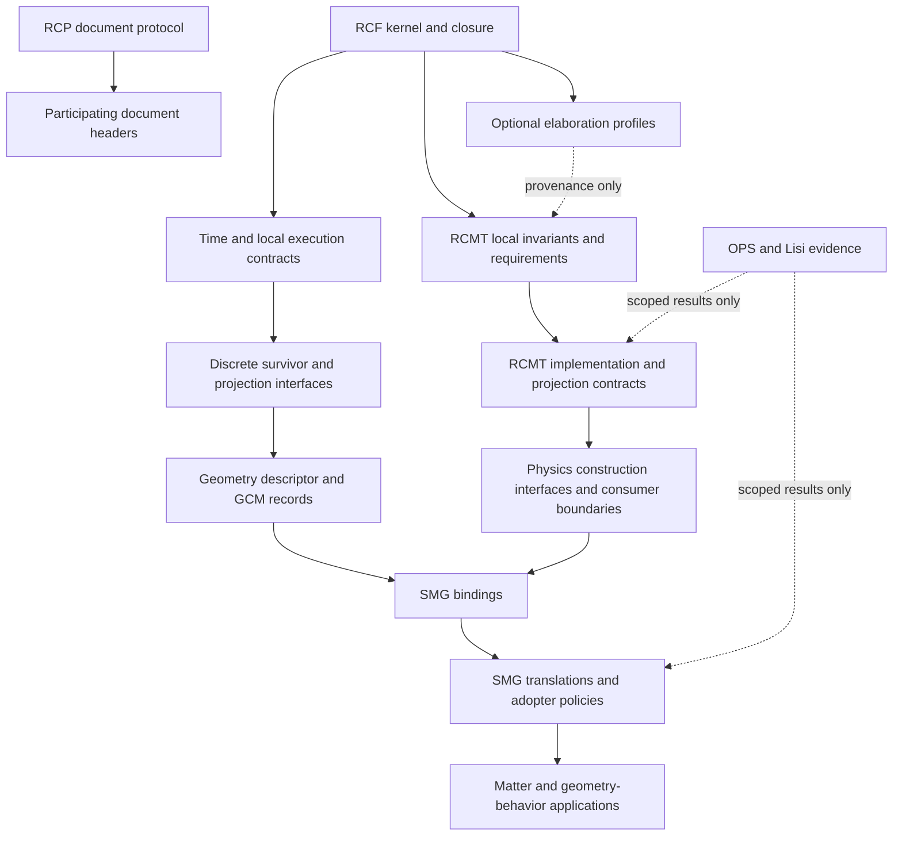

# Dependency reconstruction and staged migration plan

## Document Contract

- owner: Codex documentation audit
- type: Observation
- scope: proposal-only audit of authorized theory inputs, 2026-10-24
- authority: independent assessment; no authority to revise source contracts
- upstream dependencies: cited working-tree sources, captured Git history and prior scoped verification records
- status: planning proposal; source changes not executed
- purpose: propose controlled consistency and evidence-language repairs
- anti-backflow: proposed downstream clarifications cannot redefine upstream invariants or promote hypotheses into source authority

## Authority and propagation direction

This is a map for review/propagation, not a derivation of the theory. RCP governs document structure without adding scientific invariants. Evidence arrows do not confer authority to revise parent contracts. The optional RCF memory/motion profile is historical rationale; current RCMT adoption needs its own decision record. [rcf/rcp-1.2.md:167](C:/Users/blaur/projects/theory/rcf/rcp-1.2.md:167), [rcf/core/relational-constraints/geometry.md:3](C:/Users/blaur/projects/theory/rcf/core/relational-constraints/geometry.md:3), [rcmt/local/README.md:13](C:/Users/blaur/projects/theory/rcmt/local/README.md:13)

## File-resolution plan

| Reference family | Current defect | Minimal proposed resolution | Propagation checkpoint |
|---|---|---|---|
| GCM mode binding | `gcm_interface/mode_structure.md` absent | Confirm `rcf/modules/gcm_interface/survivor_indexing.md` §3 is the intended public index import | No new raw adjacency/action payload inferred; conditional scope retained |
| Physics support/boundaries | Binding omits `local/`; boundary sources named generically | Point to `rcmt/physics_interface/local/conversion_laws/formal_structure.md` §§1/6 and distinguish schema from instance | Check consumer class and source ownership |
| RCMT root tree | Root-level conceptual filenames no longer exist | List actual `local/constraints/`, `physics_interface/`, `global/`, `smg_v2.1/`, `modules/` | Every new navigation link resolves; no authority chosen by folder name |
| RCF projection file list | Underscore/hyphen mismatch | Match the existing exact filenames | Link-only diff; no formula changes |
| Compressed source aliases | `rcf_projects/rcf_compressed.md` and predecessor protocol paths outside audited inputs | Use current RCF source contracts plus a versioned subordinate compressed snapshot | Do not inspect/import unrelated trees to force a match |
| SMG refactor/routing status | Status file absent, proposed routing requirements unbound | Create a factual status registry only after adoption facts are approved | Do not invent refactor completion or activate proposed requirements |

Sources: [rcmt/smg_v2.1/bindings/gcm_bindings.md:36](C:/Users/blaur/projects/theory/rcmt/smg_v2.1/bindings/gcm_bindings.md:36), [rcmt/smg_v2.1/bindings/physics_bindings.md:12](C:/Users/blaur/projects/theory/rcmt/smg_v2.1/bindings/physics_bindings.md:12), [rcmt/README.md:50](C:/Users/blaur/projects/theory/rcmt/README.md:50), [rcmt/local/README.md:3](C:/Users/blaur/projects/theory/rcmt/local/README.md:3), [rcf/modules/geometry/projection/README.md:92](C:/Users/blaur/projects/theory/rcf/modules/geometry/projection/README.md:92).

## Stage 0 — preserve the audit boundary

Record current source SHAs, dirty-file status, hash manifests and relevant history. Preserve original OPS mixed records, frozen SMG comparison reference, Lisi coordinates and past failed results. This proposal already captures the source baseline and local history; see `evidence/`. The closing byte comparison is `evidence/source-integrity.json`. A commit SHA alone does not cover pre-existing modified Python caches.

**Exit criterion:** no source changes in this planning pass; every proposed edit maps to a ledger ID, owner and future authorization. No scientific test reruns are needed to approve a path-only repair.

## Stage 1 — approve scope decisions before editing semantics

Resolve D1–D10 as applicable. The critical first gate is whether RCMT retains its current two-domain requirement, adopts functional separation with shared representation, or moves the split into an opt-in profile. The least-change recommendation is to retain the requirement and annotate its provenance, with mathematical realization still open. Define which physics contracts address construction modules versus effective consumers. Clarify whether global compactness is a stricter representation profile.

**Exit criterion:** a concise decision record states retained requirements, rejected alternatives and exactly which files inherit the choice. No cleanup worker infers a decision from a missing proof, commit recency or a successful downstream simulation.

## Stage 2 — one small editorial batch

After implementation authorization, apply only resolved navigation/schema-path corrections, conditional-status labels, typo/formatting repairs and historical-plan annotations (C16/C17/C20/C21/C26 and factual parts of C18). Header migration follows the agreed protocol scope; leave scientific claims untouched in this batch. Preserve frozen-reference bytes with external manifests/notes rather than in-place modernization.

**Checks:** resolve all changed links; preview math; verify no variable, inequality, coefficient, requirement or import permission changed; compare source diffs against the authorized IDs. Do not rename the misspelled SMG filename without updating its incoming references or a compatibility alias.

## Stage 3 — owner contracts in dependency order

1. Resolve RCP sentinel wording and active-header migration classification (C19); do not manufacture owner authority.
2. Clarify upstream optional-profile language, LCO/policy/GCO actors, accepted-update conditions, and projection-consistency typing within approved scopes (C01/C09/C10/C11/C12).
3. Attach regime-scoped numerical/evidence metadata and clarify geometry descriptor permissions (C06/C07/C08/C13/C14/C15/C29). Preserve table values pending source recovery.
4. Apply approved RCMT invariants/constraint/compactness/consumer-boundary decisions (C01–C06/C28), followed immediately by the summaries and interfaces that consume them.

**Atomic review rule:** do not leave an “active” downstream consumer claiming an import that the same batch removes upstream. Either migrate both ends together or mark the consumer explicitly pending/inactive with the previous version named. Unresolved sections may retain their old text with a conflict annotation; no forced implementation is needed to make every page agree.

**Checks:** each changed normative sentence cites its owning contract; each mathematical expression has a defined domain/codomain; preserved meanings and intentional changes are listed separately. A changed group symbol, compactness scope or lane-independence rule is never classified as formatting.

## Stage 4 — downstream propagation and evidence calibration

Update GCM public descriptor imports before SMG bindings. Then update SMG claim/dictionary/translation/policy/export consistency, followed by matter/geometry-behavior consumers that actually depend on a changed guarantee. Preserve already well-scoped gauge/spinor/zeta and candidate-matter language; do not rewrite every downstream document solely for tone. Update only reverse dependencies that quote changed clauses or expose changed payloads.

Add dated status notes for theorem/proof and exact algebra upgrades, the Lisi no-correspondence result and local singleton obstruction (C23/C25/C30). Keep historical SIM15.4 failures alongside SIM15.5's distinct normalizer success. Global Phase 6C and full H4-family status stay report-only unless separately reproduced in a later authorized task.

**Checks:** every upgraded claim carries assumptions, source revision and verification level; physical validity is never inferred from theorem or code success. Verify that no metadata-only change silently adds missing evidence or changes the retained symmetry action.

## Stage 5 — derived artifacts last

Rebuild the compressed shard and indexes only after source batches settle (C27). Record source commit(s), complete file manifest, build method/version, included/excluded classes and reproducible hashes. Preserve frozen Lisi comparison input as a distinct historical artifact; a new comparison against updated SMG is separate research, not documentation migration.

**Checks:** generated authority never outranks sources; kernel summary retains sections 1–9 plus closure §10; optional RCF profile remains optional; RCMT status matches approved decisions. Run structural document validation rather than asserting compliance from field presence alone. Executable examples changed under C11 warrant targeted checks of the actual acceptance contract; unchanged research mathematics does not need broad expensive reruns.

## Review packages and rollback

Prefer small review packages: navigation/status; upstream contract clarifications; RCMT architectural decision propagation; evidence-language notes; derived regeneration. Attach ledger IDs and before/after semantic summaries to each. Retain source-revision snapshots so a rejected wording change can be reverted without altering archived research results. Do not delete failed hypotheses or overwrite coordinates to make a package pass.

This report proposes the migration sequence only. No source batch, publication, new theory investigation or new computational program is initiated.
