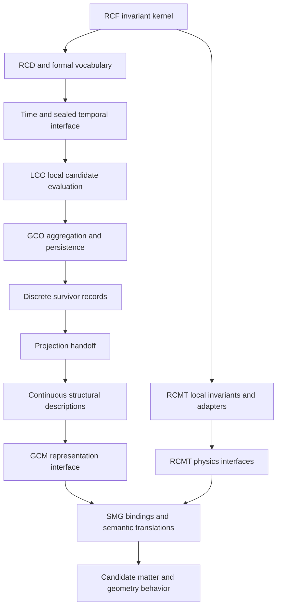

# Architecture and dependency reconstruction

## Document Contract

- owner: Codex independent onboarding audit
- type: Observation
- scope: inspected theory workspace, 2026-10-24
- authority: audit notes only; no authority over research sources
- upstream dependencies: cited source documents and recorded execution evidence
- status: completed onboarding assessment with explicit verification limits
- purpose: reconstruct existing research and classify its evidence
- anti-backflow: this report does not revise upstream definitions or promote implementations and interpretations to invariants

## Dependency direction

RCF defines a domain-neutral constraint framework. RCMT consumes it to constrain physics-oriented models. SMG is a further downstream semantic translation model, not the RCF kernel and not the physics-interface owner. OPS and the Lisi study are research implementations used to examine particular finite constructions; successful execution cannot grant them upstream authority.

This is a reconstruction of ownership and consumption, not an asserted universal chronology or a demonstrated physical emergence chain. RCD is a formal language, not an evolution law. The LCO and GCO contracts separate local evaluation from aggregation; geometry interprets their records downstream. Projection consumes survivors without selecting them or supplying a metric. Sources: [rcf/core/rcd/README.md:20](C:/Users/blaur/projects/theory/rcf/core/rcd/README.md:20), [rcf/modules/lco/README.md:1](C:/Users/blaur/projects/theory/rcf/modules/lco/README.md:1), [rcf/modules/geometry/projection/README.md:51](C:/Users/blaur/projects/theory/rcf/modules/geometry/projection/README.md:51), [rcf/modules/gcm_interface/README.md:1](C:/Users/blaur/projects/theory/rcf/modules/gcm_interface/README.md:1), [rcmt/local/README.md:13](C:/Users/blaur/projects/theory/rcmt/local/README.md:13).

## Interfaces that matter

| Boundary | Authorized content | Boundary to preserve |
|---|---|---|
| Kernel → modules | Nine framework invariants | No mechanisms, physical meanings, or candidate geometries become kernel axioms |
| Time → Temporal Interface → LCO | Event ordering, declared density input, sealed scoped weights | LCO cannot retune gamma/epsilon or schedule events |
| LCO → GCO | Candidate admissibility and local diagnostics with provenance | Local score is not a global geometry selector |
| Discrete geometry → projection | Survivor structure and preserved relational content | No metric, spacetime, or physical law introduced by the handoff alone |
| GCM → SMG | Chromatic index, plateau labels, sectors/adjacency descriptors | Evaluated-survivor descriptors are conditional; SMG labels do not backflow |
| RCMT local → physics interfaces | Explicit local records and staged handoffs | No physics-time before time bridge; no metric before emergent metric geometry |
| SMG → adopters | `8+3+1`, three-generation semantics, continuous approximations | Opt-in domain obligations, not universal physics exclusions |

Sources: [rcf/core/S∞.RCF.Invariants.v1.1.md:20](C:/Users/blaur/projects/theory/rcf/core/S∞.RCF.Invariants.v1.1.md:20), [rcf/modules/temporal-interface/interface.md:14](C:/Users/blaur/projects/theory/rcf/modules/temporal-interface/interface.md:14), [rcf/modules/lco/interface.md:14](C:/Users/blaur/projects/theory/rcf/modules/lco/interface.md:14), [rcmt/physics_interface/README.md:1](C:/Users/blaur/projects/theory/rcmt/physics_interface/README.md:1), [rcmt/physics_interface/local/time_bridge/README.md:1](C:/Users/blaur/projects/theory/rcmt/physics_interface/local/time_bridge/README.md:1), [rcmt/smg_v2.1/smg_contract.md:15](C:/Users/blaur/projects/theory/rcmt/smg_v2.1/smg_contract.md:15).

## OPS's role

SIM14 freezes an eight-state graph, projection pairing, and half-turn, then tests alternative symplectic pairings and resulting group actions. SIM15 tests the recovered abstract extension architecture in an H4 environment and measures native incidence. SIM16 studies compatible complex structures, metrics, projection, and local generator spaces on the frozen OPS representation. They do not implement the missing physical dynamics. In particular, the permutation `p`, basin-observation map, and RCF's general projection operator are different objects until an explicit connecting map is supplied. [projects/Operational_Phase_Space/Vocabulary_Packet.md:64](C:/Users/blaur/projects/theory/projects/Operational_Phase_Space/Vocabulary_Packet.md:64), [projects/Operational_Phase_Space/SIM15.0.py:1](C:/Users/blaur/projects/theory/projects/Operational_Phase_Space/SIM15.0.py:1), [projects/Operational_Phase_Space/SIM16.3.py:1](C:/Users/blaur/projects/theory/projects/Operational_Phase_Space/SIM16.3.py:1)

The Lisi study takes a separate route: supplied adjacency → tetrahedral duality → graph-defined inscribed 24-cells → named projective state actions → 20-vertex target fibers → configurations. Its Phase 6 compares that enriched object with a frozen concatenated SMG reference. It does not demonstrate that this is the same realization as OPS's H4 construction or the current RCMT mode-space candidate. [projects/lisi-smg-test/REPORT_LISI_120CELL_TRANSPORT.md:17](C:/Users/blaur/projects/theory/projects/lisi-smg-test/REPORT_LISI_120CELL_TRANSPORT.md:17), [projects/lisi-smg-test/REPORT_PHASE6.md:14](C:/Users/blaur/projects/theory/projects/lisi-smg-test/REPORT_PHASE6.md:14)

## Competing interface descriptions requiring review

The `physics_interface/README.md` permits declared upstream constraints, project-local adapters, and interface records. The `pipeline/physics_interface_contract.md` instead describes a projection-output-only firewall and prohibits consuming adjacency, upstream modes, and coherence scores. SMG explicitly imports structural support through GCM plus physics-interface records. These may be distinct consumer stages, but the reviewed files do not provide an explicit reconciliation or supersession declaration. Preserve the narrower permissions at each named boundary; do not merge the contracts silently. [rcmt/physics_interface/README.md:1](C:/Users/blaur/projects/theory/rcmt/physics_interface/README.md:1), [rcmt/physics_interface/pipeline/physics_interface_contract.md:1](C:/Users/blaur/projects/theory/rcmt/physics_interface/pipeline/physics_interface_contract.md:1), [rcmt/smg_v2.1/smg_contract.md:15](C:/Users/blaur/projects/theory/rcmt/smg_v2.1/smg_contract.md:15)

Likewise, RCMT's introductory claim that it supplies mechanisms must be read alongside the local LCO consumption contract's prohibition on treating LCO as a dynamical mechanism or causal agent. The contracts support a representational research architecture; they do not establish those advertised physical explanations. [rcmt/README.md:16](C:/Users/blaur/projects/theory/rcmt/README.md:16), [rcmt/local/constraints/lco.md:27](C:/Users/blaur/projects/theory/rcmt/local/constraints/lco.md:27)
